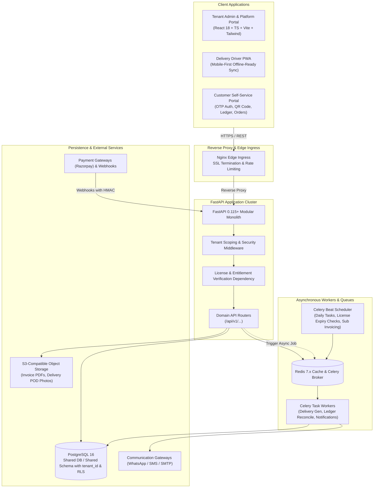
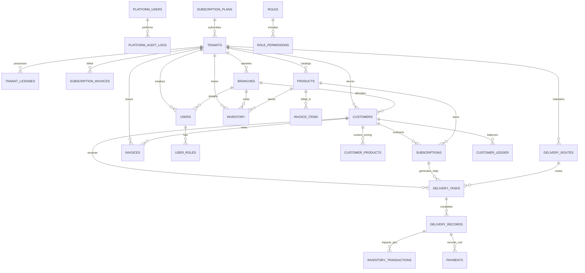

# AquaFlow SaaS Platform Architecture Documentation

## 1. Executive Summary & System Vision
**AquaFlow** is an enterprise-grade, multi-tenant SaaS platform engineered specifically for water delivery businesses, RO water plants, packaged drinking water distributors, and bulk water logistics agencies. The platform provides a robust two-plane operational model:
1. **Platform Administration (Super Admin SaaS Control Plane)**: Subscription lifecycle management, licensing & entitlement enforcement, tenant provisioning, revenue analytics (MRR/ARR/Churn), platform audits, and support impersonation.
2. **Tenant Operations Plane**: Multi-branch business administration, customer ledger and tiered pricing, returnable container (20L jar) tracking, route and shift optimization, automated delivery schedule generation, GST billing, payroll, driver PWA, and customer self-service portal.

---

## 2. High-Level System Architecture

---

## 3. Multi-Tenant Isolation & Security Model

### 3.1 Tenant Identification & Context Binding
- **No Client Spoofing**: The client never passes `tenant_id` as a trusted parameter for authorization.
- **JWT Context**: Every authenticated user access token contains `sub` (user_id), `tenant_id`, `role`, and assigned `branch_ids`.
- **Python ContextVar Scoping**:
  A Python `ContextVar[Optional[UUID]]` (`current_tenant_id`) is initialized via an ASGI middleware / dependency per request.
- **SQLAlchemy Query Scoping**:
  All tenant-scoped models inherit from a common base `TenantAwareModel` providing `tenant_id` (indexed, foreign key to `tenants.id`, cascade-restrict).
  A centralized repository pattern automatically applies `.filter(Model.tenant_id == get_current_tenant_id())` on all query executions unless explicitly elevated by a platform super admin context.
- **Database Row Level Security (RLS)**:
  PostgreSQL RLS policies are enabled on tenant tables as a defense-in-depth layer using `current_setting('app.current_tenant_id', true)`.

### 3.2 License & Entitlement Enforcement Engine
1. **Middleware & Dependency Hook**:
   Every tenant-scoped request passes through `verify_tenant_license_status()`.
2. **State Machine**:
   - `TRIAL` $\to$ `ACTIVE` $\to$ `GRACE_PERIOD` $\to$ `EXPIRED` $\to$ `SUSPENDED`
3. **Hard Enforcement**:
   - When a tenant license reaches expiration date + grace period, status transitions to `EXPIRED`.
   - All write operations (creating deliveries, creating invoices, dispatching stock, adding customers) are immediately blocked with HTTP `402 Payment Required` and payload `{ "code": "LICENSE_EXPIRED", "renewal_url": "/app/subscription/renew" }`.
   - Read access is strictly restricted to viewing historical bills, financial export, and accessing the renewal/checkout gateway.
   - Platform super admins can independently issue `SUSPENDED` status overriding all active licenses.

---

## 4. Database Architecture & ERD Overview

---

## 5. Domain Modules Breakdown

| Module | Core Responsibilities |
|---|---|
| **Platform Admin** | Super admin dashboard, tenant management, subscription plans, license generation, global audit logs, health monitoring. |
| **Authentication & IAM** | JWT access/refresh token rotation, phone OTP login, RBAC + granular permission matrix, audited support impersonation. |
| **Tenant Onboarding** | Multi-step wizard (Profile, Products & Pricing, Jar Deposits, Opening Balances, Routes, Trial Licensing). |
| **Customer & Ledger** | Customer directory, route/group assignment, custom pricing, QR codes, debit/credit ledger, jar deposits. |
| **Product & Returnable Inventory** | Product catalog (20L jars, 1L bottles, dispensers), 8-state jar inventory ledger (warehouse filled/empty, in-transit, customer-held, damaged, lost). |
| **Subscription & Scheduling** | Daily, alternate-day, weekly, selected-days schedules, shift assignment (morning/evening), automatic task generation with idempotency keys. |
| **Delivery Operations & Mobile PWA** | Driver mobile app, offline delivery logging with sync queue, POD capture, jar balance updates, COD collection. |
| **Billing & Invoicing** | Automated cycle invoices (monthly/weekly), bulk billing, GST calculation (CGST/SGST/IGST), PDF receipts, payment gateway (Razorpay). |
| **Staff & Payroll** | Attendance, salary tiers, delivery incentive calculation, advance management, expense approval. |
| **Notifications** | Async WhatsApp API, SMS, Email, and in-app alerts via Celery tasks. |
| **Analytics & Reporting** | Real-time sales, collection reconciliation, jar circulation velocity, driver KPIs, and churn metrics. |

---

## 6. Offline-First Delivery Sync Protocol
1. **Local Storage**: IndexedDB stores local routes, stops, and cached customer details.
2. **Idempotency Key**: Each offline delivery creates a UUID `client_transaction_id` generated on device.
3. **Reconciliation**: On reconnection, actions are sent sequentially with timestamps. Backend executes transactions inside atomic database transactions, verifying `client_transaction_id` against `delivery_records` to prevent double entry.
4. **Conflict Resolution**: Last-write-wins for customer notes, additive reconciliation for jar and cash balances.

